

  

  <strong>Full Stack Developer & Product Lead</strong> 
  9+ years across web development, product engineering and digital design. 
  I build production platforms, AI automation, business systems, custom CMS solutions and websites that convert.

  
  
  
  
  

---

## 🧭 What I do

- **Lead products end to end**: full stack products, internal platforms and client websites at [Allure Digital](https://alluredigital.net), from technical planning to production.
- **Ship business software**: finance, CRM, ERP, HR, payroll, invoicing, property, dispatch and compliance systems.
- **Build AI automation**: n8n workflows, Grok/xAI bots, LLM integrations and AI-assisted content and SEO tooling.
- **Engineer CMS platforms**: custom WordPress themes and plugins, plus a MongoDB-backed headless CMS (AVAULT) that runs many of our client sites.
- **Deliver at scale**: 50+ production websites and 400+ localized service and landing pages.
- **Run the DevOps**: I manage the production servers and CI/CD pipelines behind 1001 ToolBox, Brothers Fix, Manhattan Lead, 98 Clean Teams and our other platforms, on AWS and Linux with Nginx, PM2 and Docker.

## 🛠️ Tech stack

**Front end** 

**Back end, data and AI** 

**DevOps, servers and deployment** 

---

## 🚀 Products I've built

> Previews play automatically. Click one for the full 20-second video. 🔒 Most of these are private client or company repositories; links go to the public ones.

### Business operations software

<table>
  <tr>
    <td width="50%" valign="top">
      <a href="assets/videos/1001toolbox.mp4">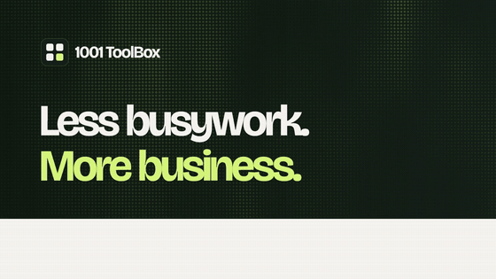</a> 
      <strong>1001 ToolBox</strong> 
      One suite for small-business busywork that brings Payloom, Keystone and Porchlight together. 
      Next.js · TypeScript
    </td>
    <td width="50%" valign="top">
      <a href="assets/videos/payloom.mp4">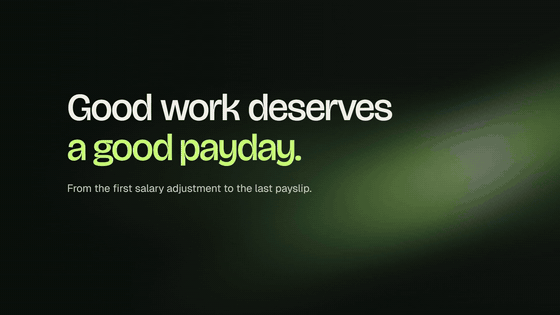</a> 
      <strong>Payloom</strong> 
      Payroll with monthly runs, payslips and income-tax working. 
      Next.js · MongoDB
    </td>
  </tr>
  <tr>
    <td width="50%" valign="top">
      <a href="assets/videos/keystone.mp4">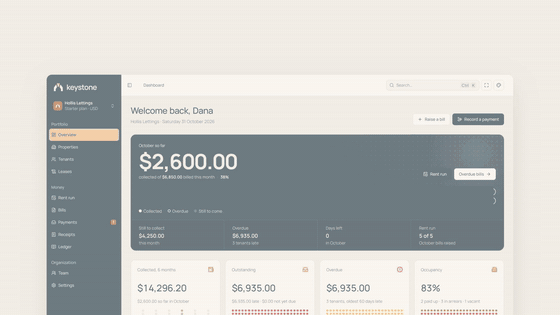</a> 
      <strong>Keystone</strong> 
      Property management with rent runs, receipts, ledgers and a tenant portal. 
      Next.js · Prisma
    </td>
    <td width="50%" valign="top">
      <a href="assets/videos/porchlight.mp4">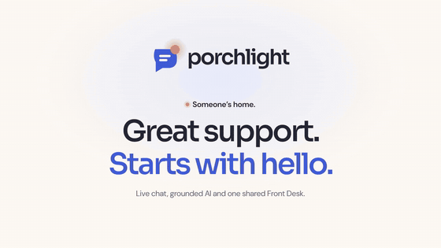</a> 
      <strong>Porchlight</strong> 
      Live chat for any website, with a support desk, saved answers and themes. 
      TypeScript monorepo · Docker · mobile app
    </td>
  </tr>
  <tr>
    <td width="50%" valign="top">
      <a href="assets/videos/quickworx.mp4">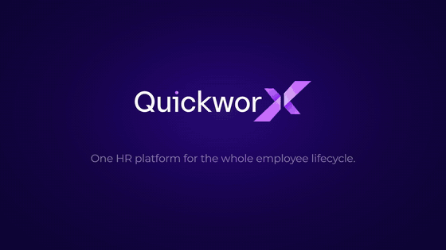</a> 
      <strong>QuickworX</strong> 
      One HR platform for the whole employee lifecycle: hiring, people, time, pay and work, plus a mobile app. 
      Laravel · Vue/Inertia · Expo
    </td>
    <td width="50%" valign="top">
      <a href="assets/videos/brothersfix-erp.mp4">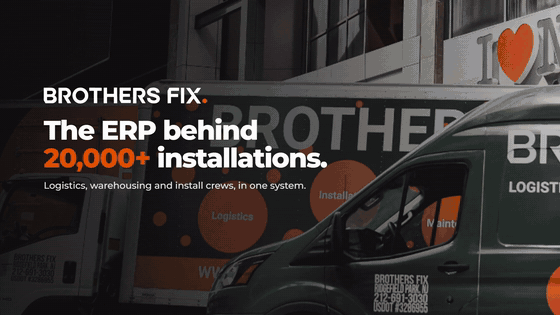</a> 
      <strong>Brothers Fix ERP</strong> 
      Field-service ERP covering jobs, crews, live fleet GPS, warehouse, job chat with AI summaries and completion reports. 
      React · Express · MongoDB · Socket.IO · Expo
    </td>
  </tr>
  <tr>
    <td width="50%" valign="top">
      <a href="assets/videos/98-clean-teams.mp4">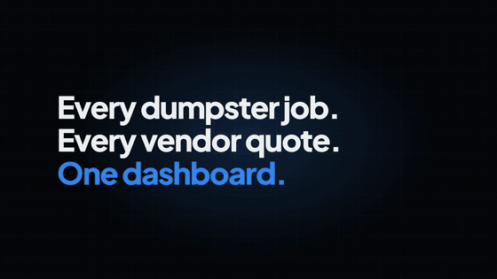</a> 
      <strong>98 Clean Teams</strong> 
      Operations platform for a dumpster rental company: jobs, vendor quote links, approvals and real-time notifications. 
      React · Express · MySQL · WebSockets · CI/CD
    </td>
    <td width="50%" valign="top">
      <a href="assets/videos/alluredispatch.mp4">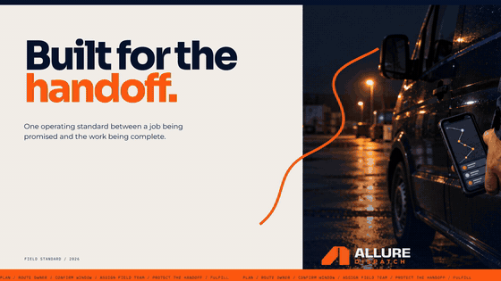</a> 
      <strong>Allure Dispatch</strong> 
      Plan, route and fulfil. Dispatch and document workflows for field-service teams. 
      Next.js · MongoDB · MySQL · Socket.IO
    </td>
  </tr>
  <tr>
    <td width="50%" valign="top">
      <a href="assets/videos/manhattan-lead.mp4">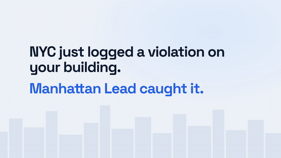</a> 
      <strong>Manhattan Lead</strong> 
      NYC lead-compliance tool: HPD open-data explorer, 6-hourly violation monitoring, client portal and inspection dispatch. 
      React · Express · MySQL
    </td>
    <td width="50%" valign="top">
      <a href="assets/videos/woodledger.mp4">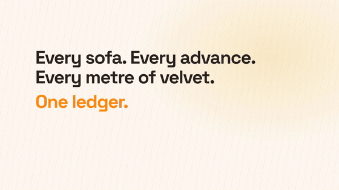</a> 
      <a href="https://github.com/ehteshamaliii/WoodLedger"><strong>WoodLedger</strong></a> 
      ERP for furniture makers covering orders, advances, production queue, payments and low-stock alerts. 
      Next.js · Prisma · MySQL · Socket.IO
    </td>
  </tr>
  <tr>
    <td width="50%" valign="top">
       
      <strong>UpNext</strong> 
      Multi-tenant project management: Kanban boards, recurring deliverables, EOD reports and a ⌘K palette. 
      Next.js · Express · MongoDB · Redis
    </td>
    <td width="50%" valign="top">
      <a href="assets/videos/quickinvoice.mp4">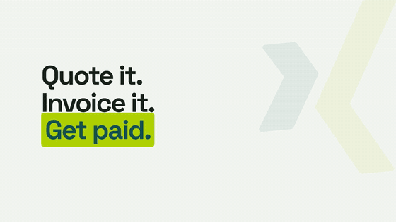</a> 
      <strong>QuickInvoice</strong> 
      Quotation to invoice in one click, payments with live notifications, and paid/pending/overdue reports. 
      React · Express · MySQL · WebSockets
    </td>
  </tr>
  <tr>
    <td width="50%" valign="top">
      <a href="assets/videos/training-tracking.mp4">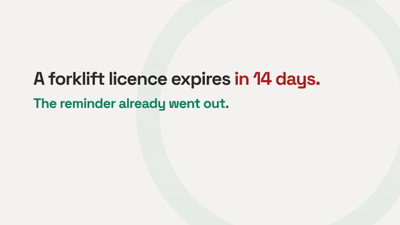</a> 
      <strong>ComplianceAI (Training Tracking System)</strong> 
      Training and certificate compliance: department dashboard, training matrix and expiry reminder rules. 
      Vue · Express · Prisma · MySQL
    </td>
  </tr>
</table>

### SEO, CMS and AI tools

<table>
  <tr>
    <td width="50%" valign="top">
      <a href="assets/videos/seobeacon.mp4">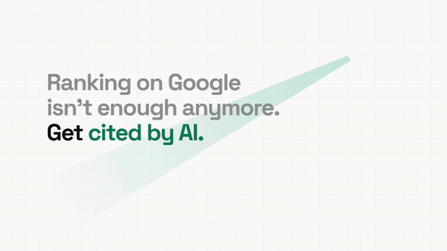</a> 
      <strong>SEO Beacon</strong> 
      AI agent for pages Google ranks and LLMs cite: GEO score, AI-crawler access, platform readiness and a content writer. 
      FastAPI · React
    </td>
    <td width="50%" valign="top">
      <a href="assets/videos/rankmetrics.mp4">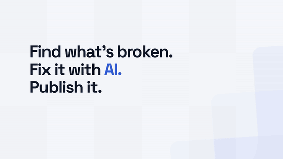</a> 
      <strong>Rank Metrics</strong> 
      SEO workspace: site audit, sitemap coverage map, AI page improvement and publishing to WordPress. 
      Next.js · Django
    </td>
  </tr>
  <tr>
    <td width="50%" valign="top">
      <a href="assets/videos/zenstatus.mp4">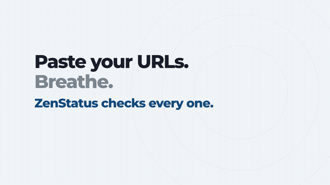</a> 
      <a href="https://github.com/ehteshamaliii/zenstatus"><strong>ZenStatus</strong></a> 
      Bulk website status checks and 0–100 SEO scores across a whole sitemap. 
      Python · Flask
    </td>
    <td width="50%" valign="top">
      <a href="assets/videos/pressblade.mp4">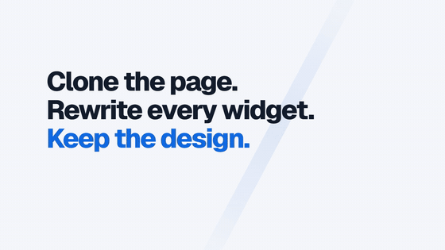</a> 
      <strong>PressBlade</strong> 
      Desktop app that reads Elementor/Bricks pages, rewrites them for a new area and writes RankMath meta. 
      Electron · React · TypeScript
    </td>
  </tr>
  <tr>
    <td width="50%" valign="top">
      <a href="assets/videos/contentbug.mp4">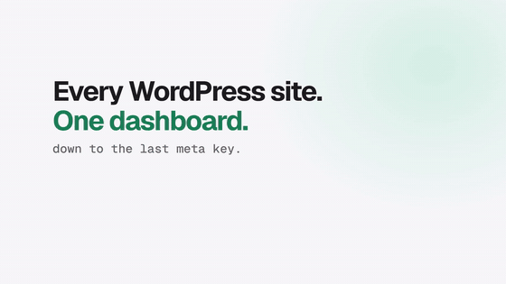</a> 
      <strong>ContentBug</strong> 
      Self-hosted control panel for many WordPress sites: builder JSON editing, one-click plugin updates, llms.txt. 
      Next.js · Prisma
    </td>
    <td width="50%" valign="top">
      <a href="assets/videos/sphere-builder.mp4">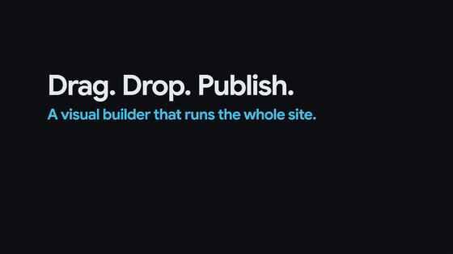</a> 
      <strong>Sphere Builder</strong> 
      Visual website builder and runtime with 118 elements, inline editing, breakpoints and revisions. 
      Next.js · TypeScript
    </td>
  </tr>
  <tr>
    <td width="50%" valign="top">
      <a href="assets/videos/cineframe.mp4">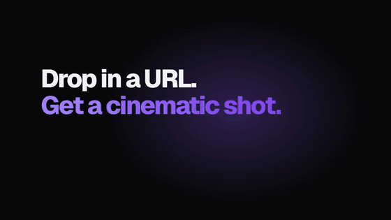</a> 
      <strong>CineFrame</strong> 
      Cinematic 3D mockups from any URL, with a live browser inside the frame and PNG export. 
      Next.js · Three.js · Puppeteer
    </td>
    <td width="50%" valign="top">
      <a href="assets/videos/hireflow.mp4">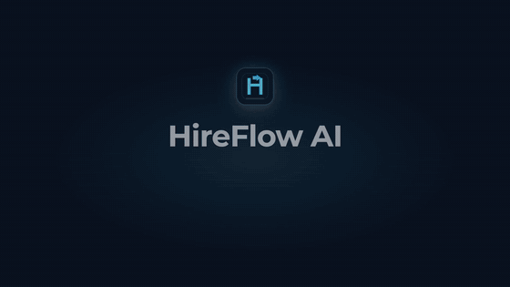</a> 
      <strong>HireFlow AI</strong> 
      AI job search pipeline: paste a job link, get a fit score and a tailored CV. Built on career-ops. 
      Node.js · Claude Code
    </td>
  </tr>
  <tr>
    <td width="50%" valign="top">
      <a href="assets/videos/presentation-maker.mp4">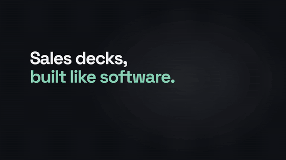</a> 
      <strong>Presentation Maker</strong> 
      The Vue codebase behind the ComplianceAI pitch deck and an FBR digital-invoicing proposal. 
      Vue 3 · Vite
    </td>
  </tr>
</table>

### Attendance and hardware

<table>
  <tr>
    <td width="50%" valign="top">
      <a href="assets/videos/argus-one.mp4">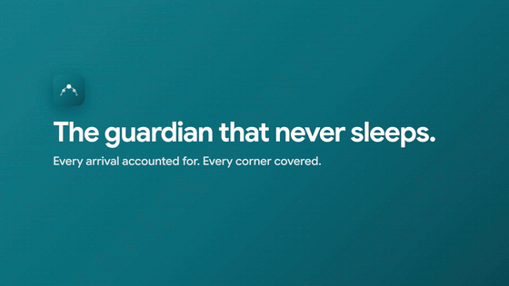</a> 
      <strong>Argus One</strong> 
      Attendance and surveillance for Windows: face recognition plus ZKTeco punches in one database, self-updating. 
      Python · Electron · React · MySQL
    </td>
    <td width="50%" valign="top">
      <a href="assets/videos/websites-showreel.mp4">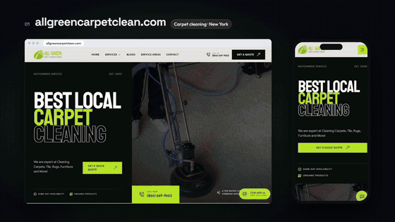</a> 
      <strong>Website showreel</strong> 
      50+ production websites and 400+ local service pages in 20 seconds. 
      Next.js · WordPress · AVAULT CMS
    </td>
  </tr>
</table>

| Also built | What it is | Stack |
|---|---|---|
| **AVAULT** | MongoDB-backed headless CMS and admin that powers our client sites (content, forms, SEO, redirects, media, backups) | Next.js · MongoDB |
| **ProFinance / ProSale / ProSphere / ProDeed** | Finance, CRM, HRM, inventory, payment scheduling, property workflows and document generation (Dynamics Solutions) | Laravel · MySQL |
| **WordPress plugins** | AI content generation and scheduling, RankMath migration, custom fields/CPTs, quizzes, Elementor/Bricks widgets, MapLibre/SVG maps, mobile.de integration | PHP · WordPress |
| **Pi Attendance** | Raspberry Pi biometric attendance | Python |

## 🌐 Websites

<table>
  <tr>
    <td width="33%" valign="top"><a href="https://allgreencarpetclean.com">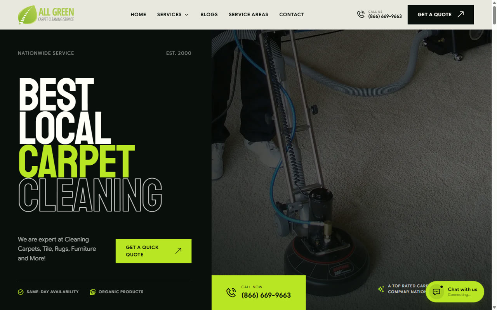</a> <a href="https://allgreencarpetclean.com">allgreencarpetclean.com</a></td>
    <td width="33%" valign="top"><a href="https://bhgeneralcontractor.com">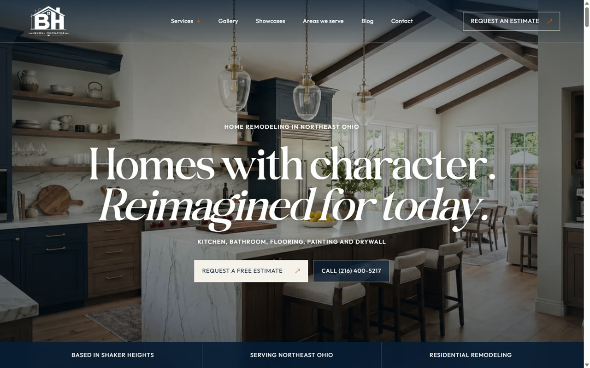</a> <a href="https://bhgeneralcontractor.com">bhgeneralcontractor.com</a></td>
    <td width="33%" valign="top"><a href="https://orangecountycarpetcleaning.com">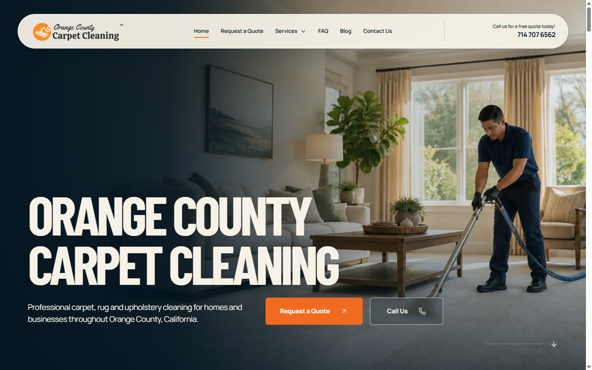</a> <a href="https://orangecountycarpetcleaning.com">orangecountycarpetcleaning.com</a></td>
  </tr>
  <tr>
    <td width="33%" valign="top"><a href="https://manhattanlead.com">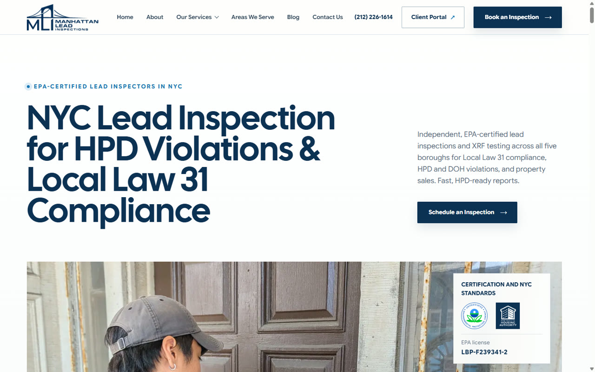</a> <a href="https://manhattanlead.com">manhattanlead.com</a></td>
    <td width="33%" valign="top"><a href="https://dmvcommercialdoorrepair.com">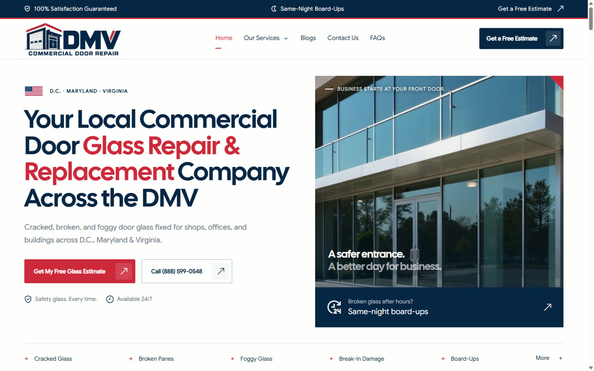</a> <a href="https://dmvcommercialdoorrepair.com">dmvcommercialdoorrepair.com</a></td>
    <td width="33%" valign="top"><a href="https://allureseo.com">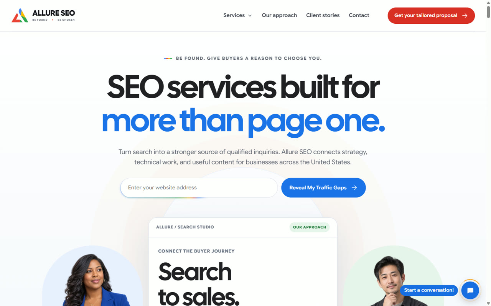</a> <a href="https://allureseo.com">allureseo.com</a></td>
  </tr>
  <tr>
    <td width="33%" valign="top"><a href="https://allgreencarpetcleanbrooklyn.com">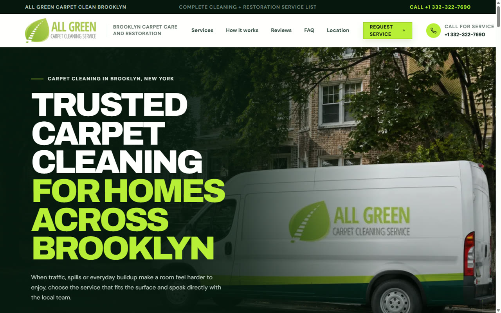</a> <a href="https://allgreencarpetcleanbrooklyn.com">allgreencarpetcleanbrooklyn.com</a></td>
    <td width="33%" valign="top"><a href="https://allgreencarpetcleanqueens.com">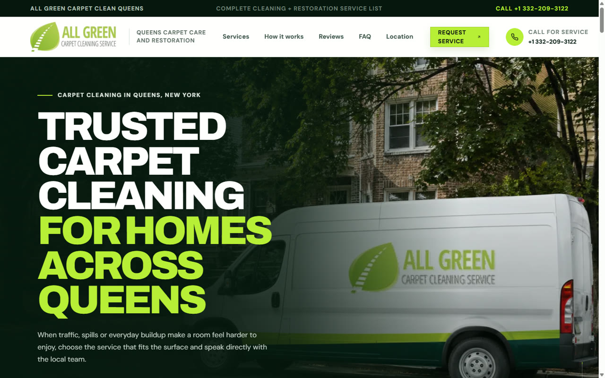</a> <a href="https://allgreencarpetcleanqueens.com">allgreencarpetcleanqueens.com</a></td>
    <td width="33%" valign="top"><a href="https://abra.com">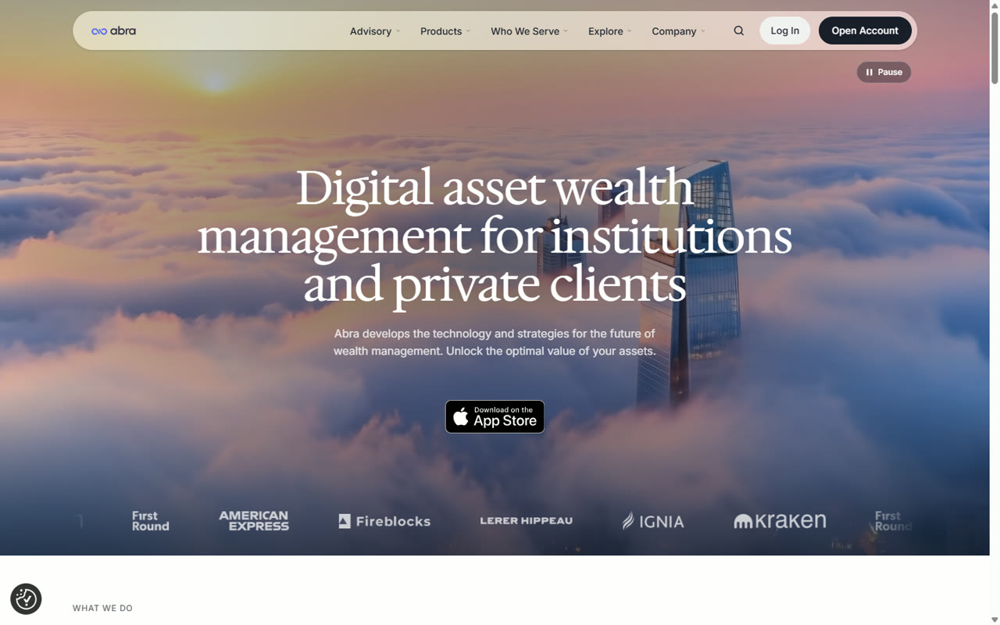</a> <a href="https://abra.com">abra.com</a></td>
  </tr>
  <tr>
    <td width="33%" valign="top"><a href="https://nycitysafe.com">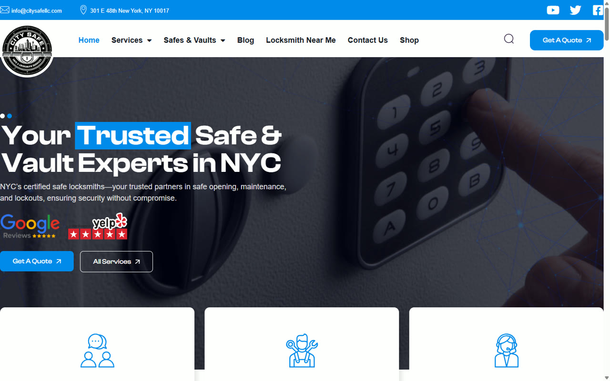</a> <a href="https://nycitysafe.com">nycitysafe.com</a></td>
    <td width="33%" valign="top"><a href="https://accuratechimneys.com">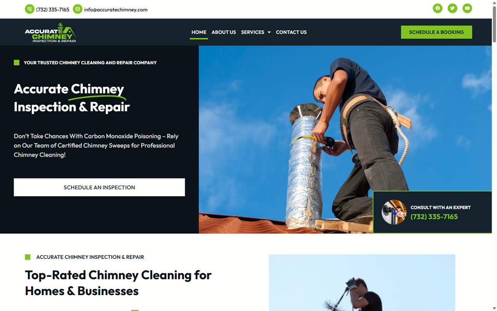</a> <a href="https://accuratechimneys.com">accuratechimneys.com</a></td>
    <td width="33%" valign="top"><a href="https://vertex-garage.com">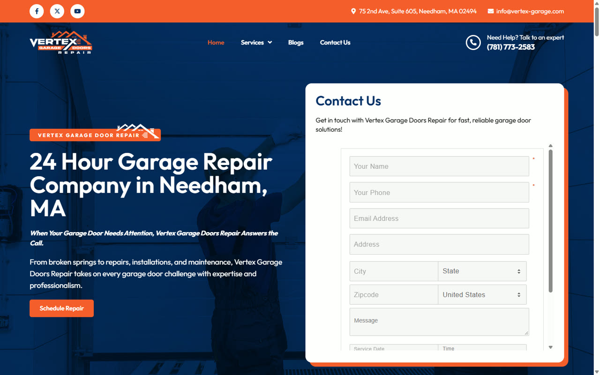</a> <a href="https://vertex-garage.com">vertex-garage.com</a></td>
  </tr>
</table>

**Also built:** Quest Mold &amp; Asbestos (3 versions), Hudson Waterfront, AirTight Insulation, Luxury Nails Lounge, Quality 1st Auto Repair

---

## 💼 Experience

| When | Role | Where |
|---|---|---|
| Aug 2025 to now | **Manager Software Developer** | Allure Digital (Remote, NJ, US) |
| Sep 2024 to Aug 2025 | **Senior Executive Web Developer** | Allure Digital (Remote, NJ, US) |
| 2024 to now | **Independent Web Developer** (5.0 rating) | Upwork |
| Jan 2024 to Sep 2024 | **Senior Full Stack Developer** | Dynamics Solutions (Islamabad) |
| Feb 2022 to Dec 2023 | **Backend Developer** | BigBookCloud (Islamabad) |
| Mar 2018 to Jan 2022 | **Graphic Designer** | Elaan Marketing (Islamabad) |
| Aug 2016 to Mar 2018 | **Junior Front End Developer** | Techcity (Lahore) |

## 📈 GitHub stats

  
  

  
  
  

Most of my work lives in private client and company repositories, so these public stats show only part of it.

---

Open to product engineering, technical leadership and freelance work. Say hello at <a href="mailto:theehteshamali@gmail.com">theehteshamali@gmail.com</a>.

