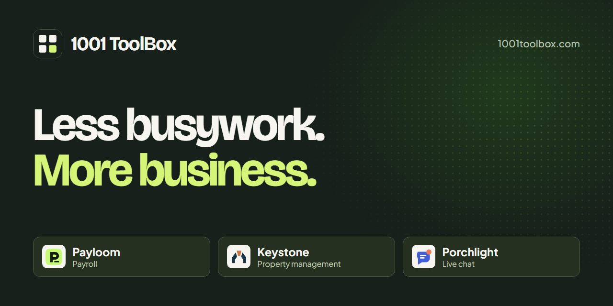
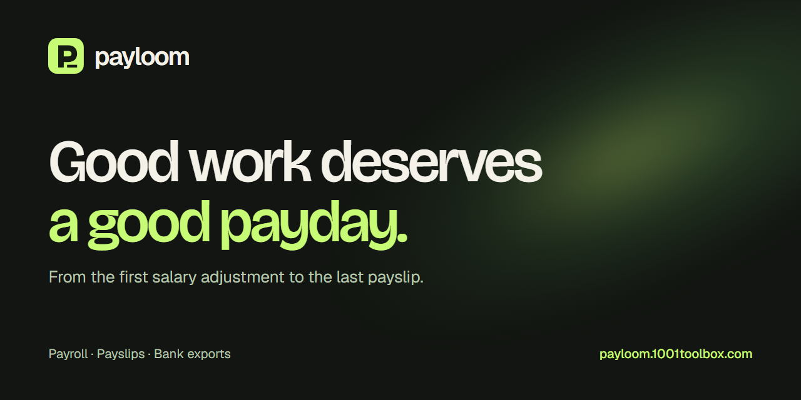
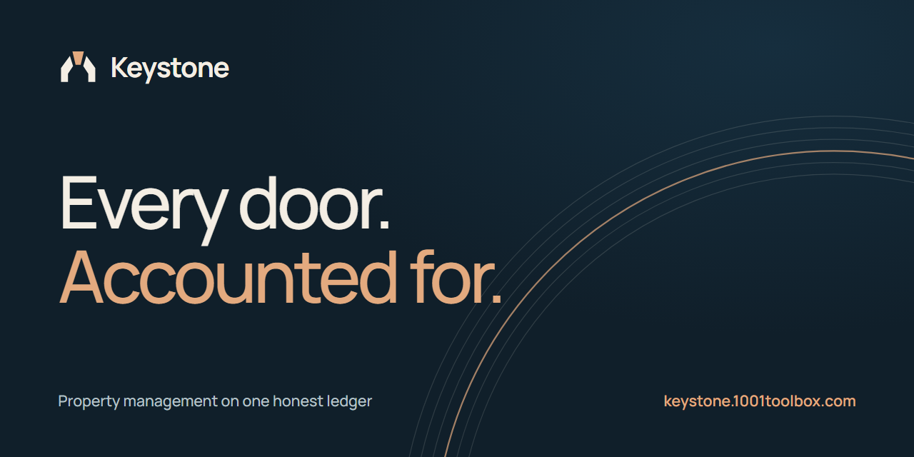
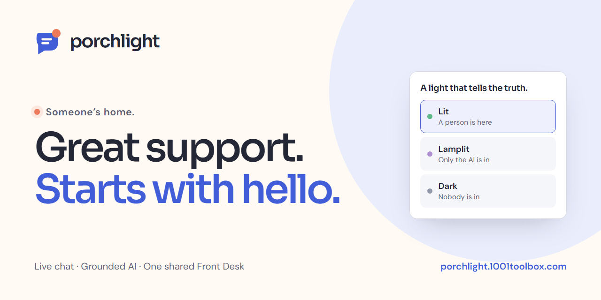
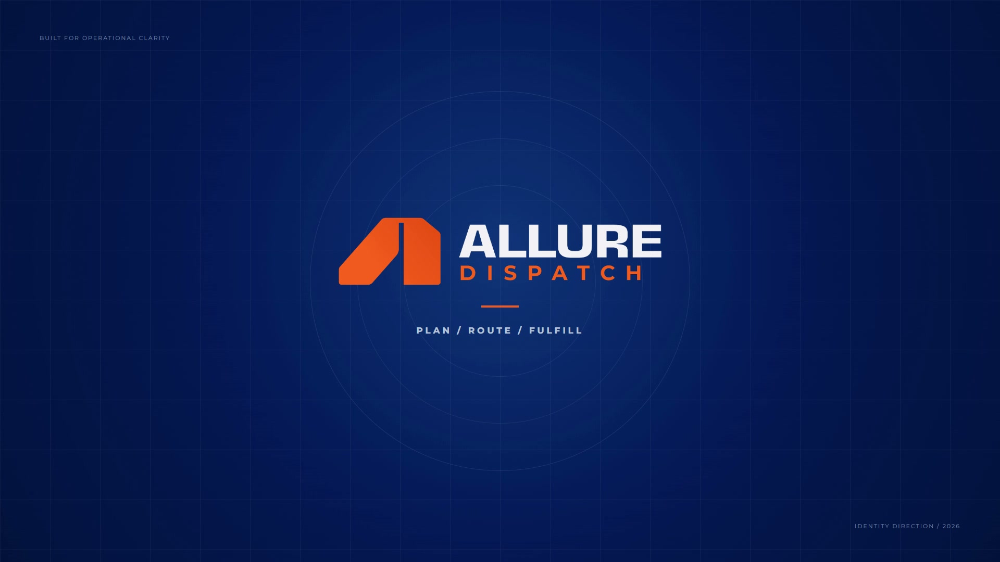

<h1 align="center">Hi, I'm Ehtesham Ali 👋</h1>

  <strong>Full Stack Developer & Software Delivery Lead</strong> 
  9+ years across web development, product engineering and digital design. 
  I build production platforms, AI automation, business systems, custom CMS solutions and websites that convert.

  
  
  
  
  

---

## 🧭 What I do

- **Lead delivery** of full stack products, internal platforms and client websites at [Allure Digital](https://alluredigital.net), from technical planning to production.
- **Ship business software**: finance, CRM, ERP, HR, payroll, invoicing, property, dispatch and compliance systems.
- **Build AI automation**: n8n workflows, Grok/xAI bots, LLM integrations and AI-assisted content and SEO tooling.
- **Engineer CMS platforms**: custom WordPress themes and plugins, plus a MongoDB-backed headless CMS (AVAULT) that runs many of our client sites.
- **Deliver at scale**: 50+ production websites and 400+ localized service and landing pages.

## 🛠️ Tech stack

**Front end** 

**Back end, data and AI** 

**Platforms and delivery** 

---

## 🚀 Featured work

<table>
  <tr>
    <td width="50%" valign="top">
       
      <strong>1001 ToolBox</strong>: one suite for small-business busywork that brings Payloom, Keystone and Porchlight together. 
      Next.js · TypeScript
    </td>
    <td width="50%" valign="top">
       
      <strong>Payloom</strong>: payroll generator with monthly runs, payslips and tax handling. 
      Next.js · MongoDB
    </td>
  </tr>
  <tr>
    <td width="50%" valign="top">
       
      <strong>Keystone</strong>: property management with rent runs, receipts, ledgers and a tenant portal. 
      Next.js · Prisma
    </td>
    <td width="50%" valign="top">
       
      <strong>Porchlight</strong>: live chat for any website, with a support desk, saved answers and light/dark themes. 
      TypeScript monorepo · Docker · mobile app
    </td>
  </tr>
  <tr>
    <td width="50%" valign="top">
       
      <strong>Brothers Fix ERP</strong>: jobs, teams, clients, warehouses, fleets and field operations in one place, plus an Expo mobile app. 
      React · Express · MongoDB · Socket.IO · Expo
    </td>
    <td width="50%" valign="top">
       
      <strong>98 Clean Teams</strong>: operations platform for a dumpster rental company covering vendors, jobs, quotations and real-time notifications. 
      React · Express · MySQL · WebSockets · CI/CD
    </td>
  </tr>
  <tr>
    <td width="50%" valign="top">
       
      <strong>Allure Dispatch</strong>: plan, route and fulfil. Dispatch and document workflows for field-service teams. 
      Next.js · MongoDB · MySQL · Socket.IO
    </td>
    <td width="50%" valign="top">
      <!-- TODO thumbnail -->
      <strong>QuickworX</strong>: one HR platform for the whole employee lifecycle (hiring, people, time, pay and work), with a companion mobile app. 
      Laravel · Vue/Inertia · Expo
    </td>
  </tr>
</table>

## 🧩 More products

**Business operations software**

| Project | What it is | Stack |
|---|---|---|
| **Manhattan Lead** | Compliance software for NYC lead inspection firms: city data extraction, monitoring, client portal, inspection scheduling | React · Express · MySQL |
| [**WoodLedger**](https://github.com/ehteshamaliii/WoodLedger) | ERP for furniture manufacturers covering orders, inventory, payments and clients | Next.js · Prisma · Socket.IO |
| **UpNext** | Multi-tenant project management | Next.js · Express · MongoDB |
| **ProFinance / ProSale / ProSphere / ProDeed** | Finance, CRM, HRM, inventory, payment scheduling, property workflows and document generation (Dynamics Solutions) | Laravel · MySQL |
| **QuickInvoice** | Invoicing and quotation software | Express · MySQL |
| **Compliance AI** | AI-assisted compliance workspace | Vue · Express · Prisma · MySQL |
| **EmployeeMatch** | Employee matching interface | React · TypeScript · Vite |

**SEO, CMS and content technology**

| Project | What it is | Stack |
|---|---|---|
| **AVAULT** | MongoDB-backed headless CMS and admin that powers our client sites (content, forms, SEO, redirects, media, backups) | Next.js · MongoDB |
| **Sphere Builder** | Standalone visual website builder and runtime with a protected visual backend | Next.js · TypeScript |
| **SEO Beacon** | AI agent that writes pages built to rank on Google and be cited by LLMs | FastAPI · React |
| **Rankmetrics** | Internal SEO platform with keyword and sitemap coverage mapping | Next.js · Django |
| [**ZenStatus**](https://github.com/ehteshamaliii/zenstatus) | Bulk website status and SEO auditing | Python · Flask |
| **PressBlade** | Desktop WordPress site intelligence: plugins, content and health | Electron · React |
| **ContentBug** | Self-hosted dashboard for managing many WordPress sites, including page-builder JSON | Next.js · Prisma |
| **WordPress plugins** | AI content generation and scheduling, RankMath migration, custom fields/CPTs, quizzes, Elementor/Bricks widgets, MapLibre/SVG maps, mobile.de integration | PHP · WordPress |

**AI tools and creative tech**

| Project | What it is | Stack |
|---|---|---|
| **HireFlow AI** | AI job search pipeline: paste a job link, get a fit score and a tailored CV. Built on [career-ops](https://github.com/santifer/career-ops) | Node.js · Claude Code |
| **CineFrame** | Cinematic product mockups from any URL, with 6-axis camera and a live browser inside the frame | Next.js · Three.js |
| **Presentation Maker** | Proposal and presentation generator | Vue 3 · Vite |

**Attendance, surveillance and hardware**

| Project | What it is | Stack |
|---|---|---|
| **Argus One** | Unified attendance and surveillance for Windows: ZKTeco device discovery, sync and monitoring | Python · Windows |
| **SAAMS** | API-based surveillance and attendance system | Python |
| **Pi Attendance** | Raspberry Pi biometric attendance | Python |

> 🔒 Most of these are private client or company repositories. Links go to the public ones.

## 🌐 Selected websites

**Production:** [abra.com](https://abra.com) · [nycitysafe.com](https://nycitysafe.com) · [accuratechimneys.com](https://accuratechimneys.com) · [vertex-garage.com](https://vertex-garage.com)

**AI-assisted launches:** [allgreencarpetclean.com](https://allgreencarpetclean.com) · [bhgeneralcontractor.com](https://bhgeneralcontractor.com) · [orangecountycarpetcleaning.com](https://orangecountycarpetcleaning.com)

**Also built:** Manhattan Lead, Quest Mold & Asbestos (3 versions), DMV Commercial Door Repair, Hudson Waterfront, AirTight Insulation, Affordable SEO San Diego, Allure SEO, Luxury Nails Lounge, Quality 1st Auto Repair, All Green Carpet Clean (Brooklyn and Queens PPC pages)

---

## 💼 Experience

| When | Role | Where |
|---|---|---|
| Aug 2025 to now | **Manager Software Developer** | Allure Digital (Remote, NJ, US) |
| Sep 2024 to Aug 2025 | **Senior Executive Web Developer** | Allure Digital (Remote, NJ, US) |
| 2024 to now | **Independent Web Developer** (5.0 rating) | Upwork |
| Jan 2024 to Sep 2024 | **Senior Full Stack Developer** | Dynamics Solutions (Islamabad) |
| Feb 2022 to Dec 2023 | **Backend Developer** | BigBookCloud (Islamabad) |
| Mar 2018 to Jan 2022 | **Graphic Designer** | Elaan Marketing (Islamabad) |
| Aug 2016 to Mar 2018 | **Junior Front End Developer** | Techcity (Lahore) |

## 📈 GitHub stats

  
  

---

Open to product engineering, technical leadership and freelance work. Say hello at <a href="mailto:theehteshamali@gmail.com">theehteshamali@gmail.com</a>.

